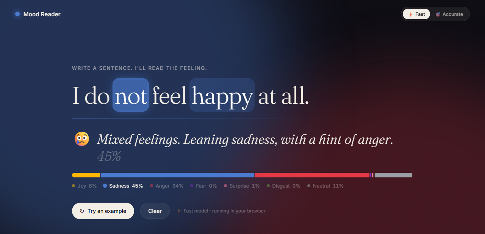
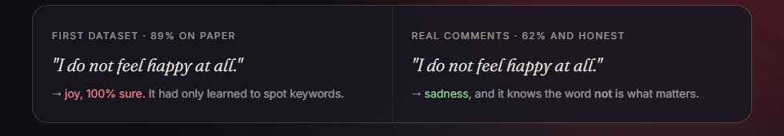
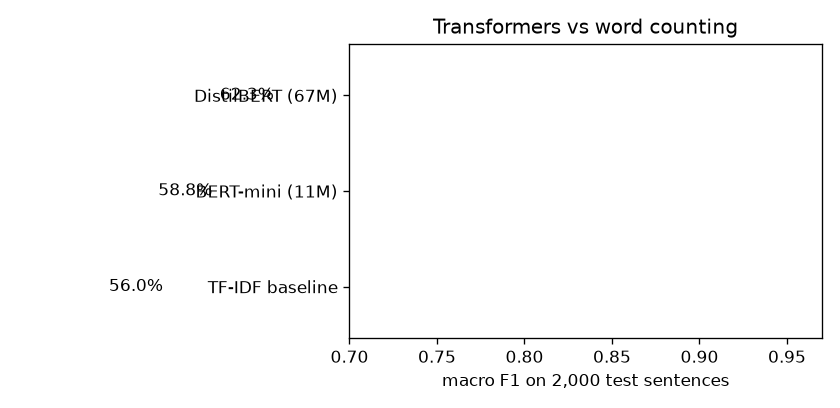
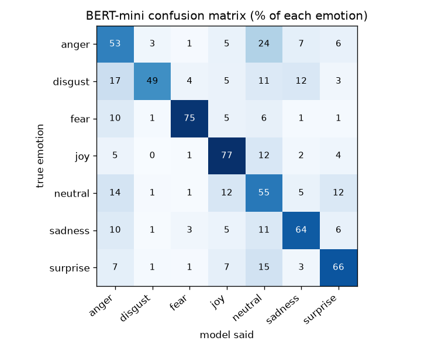

# 💬 Mood Reader

**Write a sentence. A transformer reads its emotion live, and shows which words made it decide.**

My third machine learning project and my first in NLP (natural language processing). I fine-tuned two transformer models on real Reddit comments, compressed them 4× with no loss in accuracy, and built a web app that runs them entirely in the browser.



## What it does

As you type, the model picks one of 7 emotions: joy, sadness, anger, fear, surprise, disgust or neutral. The screen fills with that emotion's colours, and the words that drove the decision light up inside your own sentence. A switch at the top lets you compare a fast 11 MB model with an accurate 67 MB one.

## The plot twist: 89% wasn't good enough

My first version used the `dair-ai/emotion` dataset and scored **88.9% macro F1**. It looked great, until I typed my own sentences:

| Sentence | First model |
|---|---|
| "i do not feel happy at all" | **joy, 100% sure** ❌ |
| "they cancelled my flight again and nobody even apologised" | **joy, 86%** ❌ |
| "i cant believe she remembered my birthday" | **sadness, 97%** ❌ |

That dataset was built from posts like *"i feel [emotion word]…"*, so the model had only learned to spot keywords. This is **dataset bias**, and the test score couldn't show it, because the test set had the same bias.

So I switched to **[GoEmotions](https://github.com/google-research/google-research/tree/master/goemotions)** (Google, CC BY 4.0): 58,000 real Reddit comments labelled by people, which I grouped into 7 emotions with Google's own mapping. The scores went **down**, but the model became honest:



| Sentence | Final model |
|---|---|
| "I do not feel happy at all." | **sadness**, and it marks **"not"** as the key word ✅ |
| "They cancelled my flight again and nobody even apologised." | **sadness, 89%** ✅ |
| "I can't believe she remembered my birthday!" | **surprise, 89%** ✅ |
| "The package arrived on Tuesday." | **neutral, 91%** ✅ |
| "Oh great, another Monday. I just love waking up at six." | joy ❌ (sarcasm is still too hard) |

## Results

All scores are on **4,968 test comments** the models never saw. Macro F1 gives every emotion equal weight, which matters here: fear and disgust are only about 1% of the data each.

| Model | Size (compressed) | Accuracy | Macro F1 |
|---|---:|---:|---:|
| TF-IDF + logistic regression (baseline) | — | 62.7% | 56.0% |
| BERT-mini, 11M parameters | 11 MB | 64.9% | 58.7% |
| **DistilBERT, 67M parameters** | 67 MB | **69.2%** | **62.5%** |



**Hardest emotions:** disgust (often read as anger) and anger (often read as neutral). Even humans disagree on these. Many of the model's most confident "mistakes" are comments labelled *neutral* that are clearly positive, so part of the error is label noise rather than the model.



## How it works

1. **Data:** GoEmotions comments that carry one clear emotion: 39,555 for training, 4,946 for validation and 4,968 for the final test.
2. **Baseline:** TF-IDF on words and word pairs, with logistic regression. It knows *which* words appear, not their order.
3. **Fine-tuning:** two pretrained transformers, DistilBERT and Google's BERT-mini, each with a new 7-emotion layer, trained in PyTorch on an RTX 4060 (about 2–4 minutes each). **Class weights** make mistakes on rare emotions count more, so the model can't just ignore fear and disgust. The best epoch is chosen on validation; DistilBERT starts to overfit after its first epoch.
4. **Compression:** both models were exported to ONNX and quantized to 8-bit integers, making them **4× smaller with the same macro F1** (58.5% → 58.7% and 62.1% → 62.5%, which is just noise).
5. **Explainability:** "leave one word out". Each word is removed in turn and the sentence is read again. The bigger the drop in the winning emotion's log-probability, the more that word mattered.
6. **Web app:** [Transformers.js](https://huggingface.co/docs/transformers.js) runs the compressed models in the browser. The fast model loads immediately; the accurate one downloads only if you switch to it. No server, and your text never leaves your device.

## What I learned

- **A high score can hide a broken model.** Testing on my own sentences found what the test set couldn't.
- **The data matters more than the model.** Switching datasets changed more than switching models did.
- **Use the right metric.** With imbalanced classes, accuracy flatters the model; macro F1 doesn't.
- **Measure trade-offs before choosing.** On the easy dataset the small model matched the big one. On real comments the big one wins by about 4 points, so the app lets you pick.
- **Compression is often free.** 8-bit quantization cut size and memory by 4× at no cost here.

## Limits

- **Sarcasm** fools it.
- **English only.**
- **One emotion per sentence:** real feelings are often mixed, which the spectrum bar shows but the single verdict simplifies.
- **About 62% macro F1:** good for real-world comments, but not reliable enough for decisions about individual people.

## Run it yourself

The web app needs no install. Serve the `demo/` folder with any static server:

```
python -m http.server 8000 --directory demo
```

Then open http://localhost:8000, or add `?text=your sentence` to the address to start with your own sentence.

To retrain:

```
python -m venv .venv
.venv\Scripts\python.exe -m pip install torch --index-url https://download.pytorch.org/whl/cu126
.venv\Scripts\python.exe -m pip install transformers datasets scikit-learn matplotlib onnx onnxruntime
```

| Script | What it does |
|---|---|
| `00_download.py` | Downloads GoEmotions and groups it into 7 emotions |
| `01_explore.py` | Emotion balance and the most typical words per emotion |
| `02_baseline.py` | TF-IDF + logistic regression baseline |
| `03_finetune.py mini` / `distilbert` | Fine-tunes a transformer with class weights |
| `04_evaluate.py` | Test scores, confusion matrix, explanations, tricky sentences |
| `05_export.py` | ONNX export, 8-bit quantization, size, speed and accuracy check |

## Built with

Python · PyTorch · Hugging Face Transformers · scikit-learn · ONNX Runtime · Transformers.js · plain HTML, CSS and JavaScript

## Credits

- [GoEmotions](https://github.com/google-research/google-research/tree/master/goemotions) by Google, CC BY 4.0.
- Pretrained models: [DistilBERT](https://huggingface.co/distilbert-base-uncased) (Apache 2.0) and [BERT-mini](https://huggingface.co/google/bert_uncased_L-4_H-256_A-4) by Google (Apache 2.0).
- The first experiment used [dair-ai/emotion](https://huggingface.co/datasets/dair-ai/emotion) for educational purposes only; it is not part of the final model.
